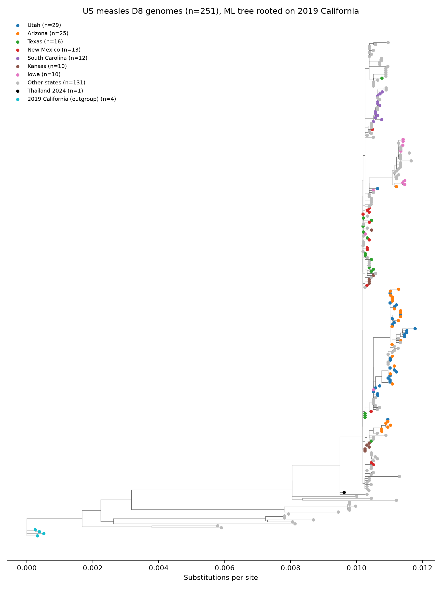

# Measles in the US: Genomic Surveillance and the Immunity Gap


In November 2026 the US lost its measles elimination status, which PAHO
determines by whether the same genotype and lineage circulated for 12 months
or more. This project builds a reproducible pipeline that pulls public US
measles genomes from NCBI, cleans their metadata, draws a balanced sample,
and infers a rooted maximum-likelihood phylogeny. The longer-term goal is to
ask whether lineages persist where vaccine coverage is lowest.

**Status: work in progress.** The genomic pipeline is complete. The vaccine
coverage comparison and transmission modeling are not started (see Roadmap).



*Maximum-likelihood phylogeny of 246 US measles D8 genomes (2025-2026) rooted on
four 2019 California genomes; the 2024 Thailand genome is shown as an ordinary
tip. Tips are colored by state for the seven best-sampled states. Sampling was
capped at five genomes per state per quarter, so counts reflect sampling effort,
not case counts. Branch order does not indicate direction of transmission.*

## Methods
1. **Retrieve metadata** for 1,247 full-length US measles records from NCBI
   (Entrez API): state, collection date, genotype.
2. **Clean** state names (abbreviations, country-only labels), genotype, and
   Distinct Sequence ID, with unit tests for each rule.
3. **Sample**: 970 records were eligible (genotype D8, known state, collected
   2025 or later). At most 5 per state per quarter were drawn with a fixed
   seed, giving 246 genomes from 38 states.
4. **Align** with MAFFT, adding four 2019 California D8 genomes as the outgroup
   and one 2024 Thailand D8 genome.
5. **Infer the tree** with IQ-TREE (K3Pu+F, 1,000 ultrafast bootstraps),
   rooted on the California genomes.

## Limitations
- **Sampling is not random.** Public genomes reflect who sequenced and
  uploaded, not how many people were sick. The per-state cap reduces, but does
  not remove, this bias. Do not read sample counts as outbreak size.
- **The tree shows genetic similarity, not transmission.** It cannot show who
  infected whom, and PAHO's decision also rests on epidemiological data.
- **Rooting is an assumption.** The 2019 California genomes form their own
  clade (about 0.006 substitutions/site from the nearest 2025-2026 sample),
  which fits their dates but is not proven by the tree. The Thailand genome
  nests inside the US sequences, so it is not used as an outgroup.
- **D8 only.** About 155 records with a blank genotype field were excluded
  rather than guessed.
- **Full-length means at least 15,700 bp.** GenBank labels many slightly short
  genomes "partial," so the filter uses length, not the label. The cutoff is a
  judgment call.
- **No sequence-quality filter yet.** Some genomes have several percent
  missing data and may sit on long branches.
- **Substitution model** was chosen by ModelFinder on an earlier 36-genome
  prototype and reused here without re-selection.
- 2026 Q4 is a partial quarter.

## Reproduce
```bash
conda env create -f environment.yml
conda activate measles-genomics
export NCBI_EMAIL="you@example.com"

# Optional: refresh metadata (NCBI grows, so results will differ from the
# committed snapshot in data/raw/all_metadata.tsv)
python workflow/scripts/fetch_all_metadata.py

python workflow/scripts/clean_metadata.py
python workflow/scripts/make_sample.py
python workflow/scripts/fetch_sample.py
python workflow/scripts/build_alignment_input.py
mafft --auto --thread 4 data/raw/sample_with_outgroups.fasta > results/aligned_full.fasta
iqtree -s results/aligned_full.fasta -m K3Pu+F -B 1000 -nm 2000 -T 4 \
  -o MT789821.1,MT789830.1,MT789840.1,MT789849.1 --prefix results/measles_full
python workflow/scripts/plot_tree_full.py
pytest
```

## Repository layout
- `workflow/scripts/` pipeline scripts; `measles_utils.py` holds the tested logic
- `tests/` pytest suite (run automatically by GitHub Actions)
- `data/raw/` metadata snapshot and sample table
- `results/` alignment-derived tree files and figure
- `fetch_sequences.py`, `build_metadata.py`, `plot_tree.py` are the original
  36-genome prototype scripts

## Roadmap
- [ ] CDC kindergarten MMR coverage by state, compared with where lineages persist
- [ ] SEIR scenario modeling of outbreak size under different coverage levels
- [ ] Sequence-quality filter and time-scaled tree
- [ ] Snakemake workflow
