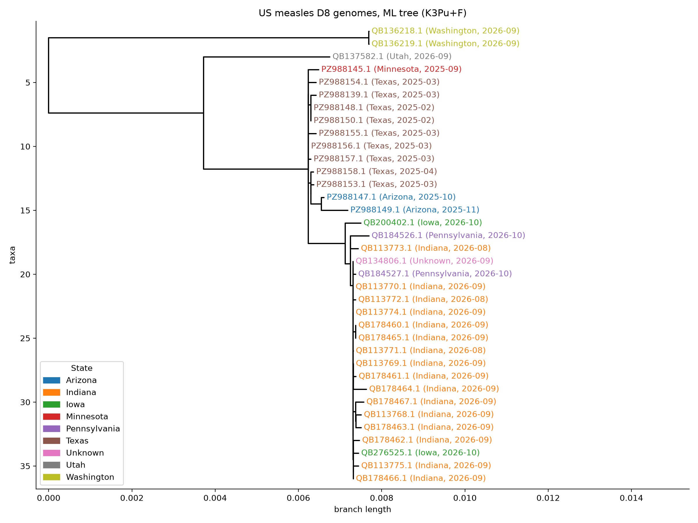

# Measles in the US: Genomic Surveillance and the Immunity Gap

Work in progress. This project asks whether measles lineages that have
circulated in the US since 2025 are concentrated where vaccine coverage
is lowest.

## Plan
1. Genomic pipeline: fetch public measles sequences, align, build a tree
2. Immunity data: CDC kindergarten MMR coverage by state
3. Integration: link clusters to coverage; SEIR scenario modeling

## Status
- [x] Repo created
- [x] Conda environment (Biopython, MAFFT, IQ-TREE)
- [x] Fetch 50 US measles sequences from NCBI
- [x] Filter to full-length genomes with metadata (36 pass)
- [x] Align (MAFFT) and build ML tree (IQ-TREE, K3Pu+F)
- [ ] Tree figure colored by state
- [ ] CDC MMR coverage data
- [ ] SEIR scenario modeling

## Reproduce
```bash
conda env create -f environment.yml
conda activate measles-genomics
export NCBI_EMAIL="you@example.com"
python workflow/scripts/fetch_sequences.py
python workflow/scripts/build_metadata.py
mafft --auto data/test/measles_test_filtered.fasta > results/aligned.fasta
iqtree -s results/aligned.fasta -m MFP -B 1000 -T AUTO --prefix results/measles
```


